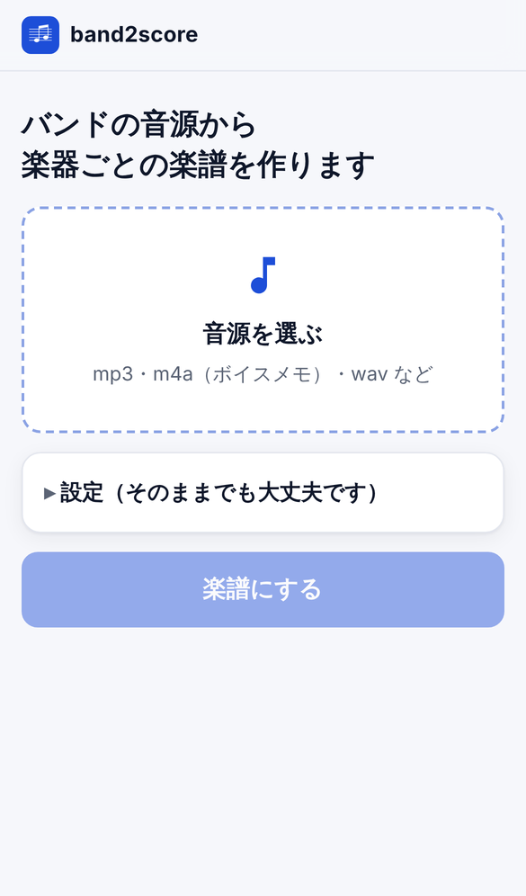
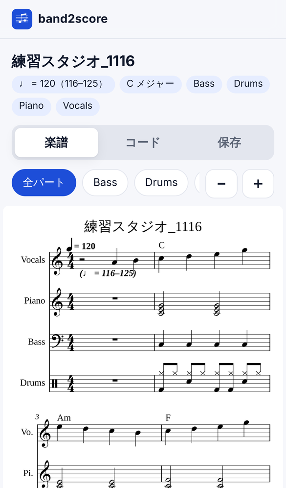
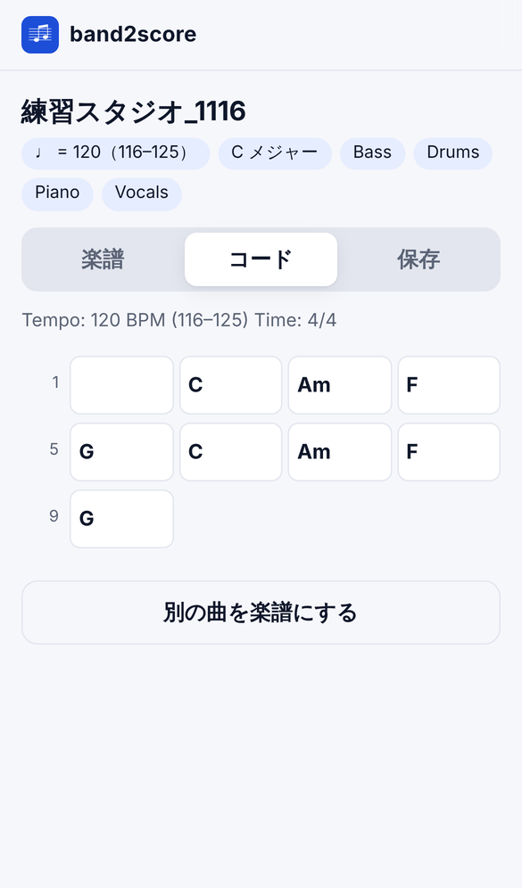

# band2score

バンドの音源（mp3 / wav など）を、**楽器ごとの楽譜**に自動で変換するツールです。

```
song.mp3
  │
  ├─ [1] 音源分離（Demucs）        … ボーカル / ギター / ベース / ピアノ / ドラム / その他 に分ける
  ├─ [2] 拍の推定（librosa）       … テンポが揺れる演奏でも 1拍ずつ追いかける
  ├─ [3] 採譜
  │     ├ 音程のある楽器 → basic-pitch（Spotify の AI 採譜モデル）
  │     ├ ドラム        → 帯域ごとの打点検出でキック / スネア / ハイハットに分ける
  │     └ コード        → ギター・ピアノなどの響き + ベースの音からコードネームを推定
  ├─ [3.5] 小節の頭を決める      … コードが変わる位置・キック・スネアの 2拍4拍から（弱起にも対応）
  └─ [4] 楽譜を作る（music21）    … リズムを 16分音符単位にそろえ、調を推定して MusicXML に
```

## 出力されるもの

`output/<曲名>/` に次のファイルができます。

| ファイル | 内容 |
|---|---|
| `<曲名>.musicxml` | 楽譜。**MuseScore**（無料）で開くと表示・編集・印刷・PDF化ができます |
| `<曲名>.mid` | 採譜結果の MIDI（DAW で鳴らして確認するとき用） |
| `<曲名>_chords.txt` | 小節ごとのコード表（下の例を参照） |
| `<曲名>.pdf` | MuseScore が入っていれば自動で作られます |
| `stems/*.wav` | 分離した楽器ごとの音声 |

## インストール

Python 3.10 以上が必要です。

```bash
python -m venv .venv
source .venv/bin/activate          # Windows は .venv\Scripts\activate
pip install -r requirements.txt
pip install --no-deps basic-pitch  # basic-pitch は依存関係が古いので別に入れる
```

- 初回実行時に Demucs のモデル（約 80MB）が自動でダウンロードされます。
- PDF も欲しい場合は [MuseScore](https://musescore.org/) を入れ、`mscore` か `musescore` コマンドが使えるようにしてください。
- NVIDIA の GPU があれば音源分離が速くなります（無くても CPU で動きます。3〜4分の曲で数分かかります）。

## 使い方

```bash
python -m band2score song.mp3
```

主なオプション:

| オプション | 説明 |
|---|---|
| `-o 出力先` | 出力フォルダを指定 |
| `--only bass drums` | 指定したパートだけ楽譜にする |
| `--tempo 128` | テンポがずれるときに BPM を手で指定 |
| `--grid 8` | リズムを 8分音符単位でそろえる（細かすぎる楽譜になるとき） |
| `--model htdemucs` | 4パート（vocals / drums / bass / other）の分離モデルを使う |
| `--stems-dir フォルダ` | 分離済みの `vocals.wav` などを使い、分離を省略する |
| `--no-chords` | コードネームを付けない |
| `--chord-beats 2` | コードを 2拍ごとに判定する（コードが細かく変わりすぎるときは 2 や 4 に） |

## スマホで使う

AI の処理が重いので、変換は PC（またはクラウドのサーバー）で行い、スマホのブラウザから
音源を送って楽譜を見る形です。アプリのインストールは不要で、ホーム画面に追加すればアプリのように使えます。

<p>



</p>

### 自宅の PC で動かす（同じ Wi-Fi のスマホから使う）

```bash
python -m band2score.web
```

表示された URL（`http://192.168.x.x:8000` のような形）をスマホのブラウザで開くか、
表示される QR コードをスマホのカメラで読み取ってください。PC とスマホが同じ Wi-Fi につながっている必要があります。

- **iPhone**: Safari で開き、共有ボタン →「ホーム画面に追加」
- **Android**: Chrome で開き、メニュー（︙）→「ホーム画面に追加」

できること:
- 音源を選ぶ（ボイスメモの m4a、mp3、wav など。スマホで録った練習の録音もそのまま使えます）
- 進み具合を見る（画面を閉じても処理は続き、「これまでの楽譜」から開き直せます）
- 楽譜を見る（パートを選んで表示・拡大縮小。ベースだけ表示してもコードネームは付きます）
- 小節ごとのコード表を見る
- MusicXML・MIDI・コード表を保存する（MusicXML は MuseScore アプリで開けます）

### 外出先からも使う（クラウドに置く）

`Dockerfile` があるので、Docker が動くサーバーならどこでも動かせます。

```bash
docker build -t band2score .
docker run -p 7860:7860 -e BAND2SCORE_PASSWORD=好きな合言葉 band2score
```

[Hugging Face Spaces](https://huggingface.co/spaces) の無料の CPU サーバーで動かせます（3〜4分の曲で 5〜10分ほどかかります）。

**PC を使わずに置く（スマホのブラウザだけでできます）**

1. [huggingface.co](https://huggingface.co) でアカウントを作り、Settings → Access Tokens →
   「Create new token」で、種類を **Write** にしてトークンを作る
2. この GitHub リポジトリの Settings → Secrets and variables → Actions →
   「New repository secret」で、名前 `HF_TOKEN`、値に 1 のトークンを貼って保存する
3. Actions タブ →「Deploy to Hugging Face Spaces」の一番上の実行を開き、右上の「Re-run all jobs」を押す
   （main ブランチに取り込んだあとは「Run workflow」ボタンからも実行できます。
   以後は、プログラムを更新するたびに自動で Space も更新されます）
4. Hugging Face の Space（`あなたのユーザー名/band2score`）の Settings → Variables and secrets →
   「New secret」で、名前 `BAND2SCORE_PASSWORD`、値を好きなパスワードにして保存する

パスワードを設定するまでは、アプリは「パスワードを設定してください」と表示して使えないようになっています。

**PC から置く場合**は、Write 権限のトークンを用意して次を実行します。

```bash
pip install huggingface_hub
HF_TOKEN=hf_xxx python deploy/huggingface.py あなたのユーザー名/band2score
```

10〜20分ほどでビルドが終わり、`https://あなたのユーザー名-band2score.hf.space` で使えるようになります。
無料の Space は 48時間使わないと休止し、次に開いたときに 1分ほどで起き上がります。

**ネットに公開するときは、必ず `BAND2SCORE_PASSWORD` を設定してください。** 設定しないと、URL を知っている人なら誰でも使えてしまいます。

| 環境変数 | 内容 |
|---|---|
| `BAND2SCORE_PASSWORD` | 使う前に求めるパスワード |
| `BAND2SCORE_MAX_MB` | アップロードできる大きさの上限（MB、既定 100） |
| `BAND2SCORE_KEEP_HOURS` | 結果を残しておく時間（既定 24 時間。過ぎると自動で消えます） |
| `BAND2SCORE_DATA` | 作業データを置くフォルダ |

## コードネーム

楽譜の一番上のパートの上に、`Cmaj7`・`Am`・`Eb/G` のようなコードネームが付きます。
同じ内容を小節ごとのコード表（`<曲名>_chords.txt`）にも書き出します。

```
Tempo: 120 BPM   Time: 4/4

  1 | Bbmaj7   | Gm7      | Eb/G F7  | Ebmaj7   |
  5 | Fsus4 F  | Dm       | C        |
```

- 判定できるコード: メジャー / マイナー / 7 / maj7 / m7 / sus4 / 7sus4 / dim と、分数コード（`C/E` など）
- ギター・ピアノなど和音の楽器の響きでコードの形を決め、ベースの一番低い音でルートと分数コードを決めます
- 調号がフラット系の曲では `A#` ではなく `Bb` のように書きます
- コードは拍単位で判定します。コードがパラパラ変わりすぎるときは `--chord-beats 2` を試してください

## 生演奏らしい曲への対応

- **テンポの揺れ**: クリック無しの演奏はテンポが少しずつ変わるので、1拍ずつの時刻（拍の格子）を求め、
  さらに採譜した音の立ち上がりに合わせて格子を微調整してから楽譜の位置を決めます。
  テンポが揺れている曲は、楽譜とコード表に `(♩ = 116–125)` のように揺れの幅も書きます
- **弱起（アウフタクト）**: コードが変わる位置・キック・スネアの 2拍4拍から小節の頭を決めるので、
  曲が 1拍目以外から始まっても小節線がずれません
- **倍音の誤検出の除去**: ボーカル・ベースの 1オクターブずれた音を直し、ピアノ・ギターの和音から
  倍音を拾っただけの弱い音を除きます
- **ピアノの 2段譜**: 音域の広いピアノは、真ん中のドで分けて大譜表（ト音記号 + ヘ音記号）にします

## 試してみる（テスト音源）

合成音で作ったテスト用のバンド音源で動作を確認できます。テンポの揺れ・弱起・タイミングの揺れも付けられます。

```bash
python tests/make_test_song.py test_data
python tests/make_test_song.py test_data --bpm 126 --bpm-end 114 --pickup 2 --humanize 12
python -m band2score test_data/test_band.wav                              # 分離から全部
python -m band2score test_data/test_band.wav --stems-dir test_data/stems  # 分離を省略
```

## 精度（ベンチマーク）

`python tests/benchmark.py` で、いくつかの演奏の条件で楽譜を作り、正解と比べます（分離済みステムを使用）。
数字は「正しい小節・拍の位置に正しい音で書かれた割合」（ピアノは取りこぼしと余分な音を両方数える F値）です。

| 条件 | ベース | メロディ | ピアノ | キック | スネア | コード |
|---|---|---|---|---|---|---|
| テンポ一定 120 | 100% | 100% | 100% | 100% | 100% | 100% |
| テンポ一定 92・1拍の弱起 | 100% | 100% | 100% | 100% | 100% | 100% |
| 2拍の弱起 | 100% | 100% | 100% | 100% | 100% | 100% |
| テンポが 112→126 に変化 | 97% | 100% | 100% | 100% | 100% | 100% |
| テンポ変化 + 弱起 + 揺れ ±12ms | 100% | 100% | 99% | 100% | 100% | 100% |

改良前（テンポ一定を前提にしていた版）は、弱起やテンポ変化がある条件で 0〜50% まで下がっていました。

コード推定は、7th・分数コード・sus4・2拍で変わるコードを含む進行
（Bbmaj7 → Gm7 → Eb/G → F7 → Ebmaj7 → Fsus4 → F → Dm → C）でも、すべてのコードと
変わる位置が正解と一致します（`tests/test_chords.py`）。

テスト音源は合成音で、楽器ごとの音も最初から分かれているため、実際の録音ではこれより下がります。

## できること・できないこと

自動採譜は完璧ではありません。**下書きを自動で作り、MuseScore で手直しする**使い方を想定しています。

- ◎ ベース・ボーカルのような単音のパートはかなり正確です
- ○ ピアノ・ギターの和音は取れますが、倍音（1オクターブ上などの音）を拾った余分な音が混ざります
- ○ ドラムはキック・スネア・ハイハットの 3種類だけを区別します（タム・シンバルは区別しません）
- ○ コードは基本的な形と 7th まで。9th・11th・13th などのテンションや aug は判定しません
- ○ テンポがだんだん変わる曲・弱起の曲に対応しています
- △ 4/4拍子以外の曲（3/4、6/8 など）や、途中で拍子が変わる曲にはまだ対応していません
- △ 1オクターブの跳躍を弱く歌った（弾いた）場合、倍音の誤検出とみなして直してしまうことがあります
- △ 分離がうまくいかない楽器（シンセ、ストリングスなど）は `Other` パートにまとめて入ります

## テスト

```bash
pip install -r requirements-dev.txt
pytest
```

## ファイル構成

```
band2score/
  cli.py         コマンドの入口・処理の流れ
  separate.py    音源分離（Demucs）
  rhythm.py      拍の格子・小節の頭の推定
  transcribe.py  採譜（basic-pitch / ドラム検出 / 倍音の誤検出の除去）
  chords.py      コード推定
  score.py       楽譜（MusicXML）と MIDI の生成
  models.py      データ型と楽器ごとの設定
  pipeline.py    処理の流れ（コマンドと Web アプリで共通）
  web/           スマホ用の Web アプリ（server.py・static/ の画面）
tests/
  make_test_song.py  テスト音源の生成（テンポの揺れ・弱起つき）
  benchmark.py       条件ごとの精度の測定
  test_pipeline.py   テスト（音符の整理・楽譜生成・ドラム）
  test_chords.py     テスト（コード推定・コード表示）
  test_rhythm.py     テスト（拍の格子・小節の頭）
  test_end_to_end.py テスト（いちばん難しい条件で分離以降を通す）
  test_web.py        テスト（Web アプリの API）
```
